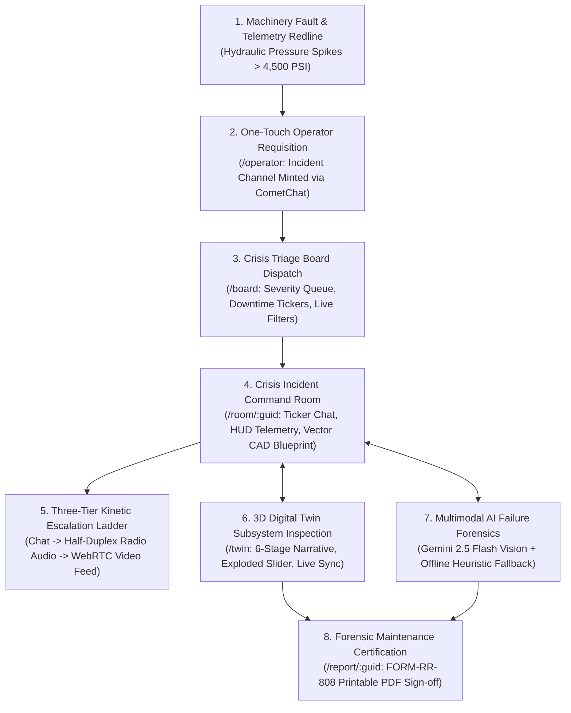
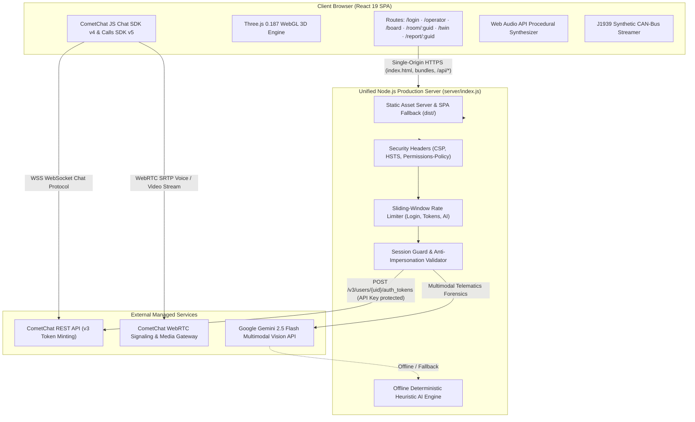
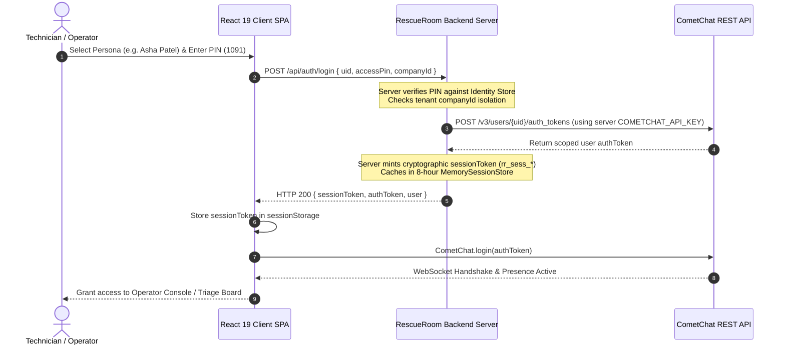

# 🚨 RESCUEROOM — Industrial Emergency Dispatch & Remote Telematics Diagnostics

[](https://rescueroom.onrender.com/)
[-brightgreen?style=for-the-badge)](https://rescueroom.onrender.com/)
[](docs/SECURITY.md)
[](docs/TESTING_AND_QA.md)
[](docs/PERFORMANCE_REPORT.md)
[](docs/ARCHITECTURE.md)
[](LICENSE)

> 🌐 **Live Cloud Production URL:** [https://rescueroom.onrender.com/](https://rescueroom.onrender.com/)  
> *Single-origin full-stack deployment featuring 3D WebGL Digital Twin, real-time CometChat communications, simulated J1939 CAN-bus telemetry, and multimodal AI machinery diagnostics.*

---

## 📑 Table of Contents

1. [Executive Overview & The Industrial Problem](#1-executive-overview--the-industrial-problem)
2. [End-to-End Operational Workflow](#2-end-to-end-operational-workflow)
3. [Key Technical Features & Innovations](#3-key-technical-features--innovations)
4. [System Architecture & Data Flow](#4-system-architecture--data-flow)
5. [Repository Folder Structure](#5-repository-folder-structure)
6. [Operational Personnel Roster](#6-operational-personnel-roster)
7. [Performance Benchmarks & Core Web Vitals](#7-performance-benchmarks--core-web-vitals)
8. [Command Reference & Quick Start](#8-command-reference--quick-start)
9. [Environment Configuration](#9-environment-configuration)
10. [Cloud Deployment Guide (Render & Vercel)](#10-cloud-deployment-guide-render--vercel)
11. [Transparent Engineering Disclosures](#11-transparent-engineering-disclosures)
12. [Technical Documentation Index](#12-technical-documentation-index)
13. [License & Credits](#13-license--credits)

---

## 1. Executive Overview & The Industrial Problem

### The High-Consequence Industrial Problem
In surface mining, aggregate quarrying, civil earthworks, and heavy freight transport, unscheduled equipment breakdowns represent severe operational and financial risk:
- **Catastrophic Downtime Costs:** Heavy mobile equipment breakdowns (e.g., 200-ton hydraulic excavators, haul trucks, wheel loaders) incur downtime costs between **\$5,000 and \$25,000 per hour** in lost production, idle haul fleets, and downstream crushing plant bottlenecks.
- **Communication Breakdown:** Remote field operators historically rely on lossy, half-duplex analog CB radios or fragmented consumer messaging apps. Complex hydraulic failure symptoms and diagnostic trouble codes (DTCs) are miscommunicated verbally, leading to incorrect parts dispatches and multi-day maintenance delays.
- **Extreme Field Environments:** Mechanics work under harsh direct solar glare, wearing high-impact industrial gloves, in ambient noise exceeding **85 dB(A)**, over volatile rural cellular/satellite connections. Consumer UI designs fail immediately due to low-contrast palettes, small touch targets, and brittle connectivity handling.

### The RescueRoom Mission
**RescueRoom** is an industrial-grade emergency dispatch, telematics telemetry, and remote diagnostics platform designed to compress the mean-time-to-repair (MTTR) of critical heavy equipment from hours to minutes.

Engineered with a **Field Manual Aesthetic** (stark ink borders, manila paper backgrounds, high-contrast monochrome typography, and tactical warning stamps), RescueRoom combines **simulated J1939 CAN-bus telemetry**, a **scroll-choreographed 3D mechanical Digital Twin**, a **3-tier kinetic escalation ladder** (Ticker Chat $\to$ Tactical Audio $\to$ Full Optical Video), and **multimodal AI failure diagnostics** (Google Gemini 2.5 Flash Vision + deterministic offline heuristic fallback) into a single, hardened multi-tenant environment.

---

## 2. End-to-End Operational Workflow

The incident lifecycle follows an auditable, closed-loop emergency workflow across 6 primary stages:



### Step-by-Step Operator & Responder Journey:
1. **Fault Detection (`/operator`):** The field operator monitors live J1939 CAN-bus telemetry gauges (Hydraulic Pressure, Oil Temp, Engine RPM). When a line ruptures or pump cavitates, clicking **`⚠ SOMETHING'S WRONG`** instantly mints a dedicated incident group in CometChat.
2. **Command Triage (`/board`):** Maintenance dispatchers and field mechanics monitor the Kanban triage queue. Active incidents display ticking live downtime clocks, equipment tags, and severity badges (`CRITICAL`, `SERIOUS`, `MINOR`).
3. **Incident Command (`/room/:guid`):** The assigned mechanic enters the incident room, featuring a unified 3-panel command dashboard: monospace ticker chat, J1939 telemetry strips, interactive vector CAD schematics with failure hotspots, and photo evidence plate uploads.
4. **Kinetic Escalation:** Teams dynamically scale communication based on ambient noise and connectivity:
   - *Rung 1 (CHAT):* Alphanumeric ticker chat with synthesized Web Audio tactical beeps.
   - *Rung 2 (VOICE):* Real-time tactical half-duplex WebRTC audio radio with live oscilloscope visualizer.
   - *Rung 3 (VIDEO):* Full-motion WebRTC video feed with HUD optical crosshairs and duration auditing.
5. **3D Twin Collaboration (`/twin`):** Responders collaborate in an interactive 3D procedural engineering model of the machinery. Changes to component focus, exploded separation, and story stages synchronize across all connected screens via CometChat custom messages.
6. **AI Forensics & LOTO Safety:** Responders invoke `RESCUE-AI` to analyze optical photos and telemetry context, outputting OEM component part numbers, torque specifications, and Lockout/Tagout (LOTO) isolation protocols.
7. **Official Sign-off (`/report/:guid`):** Upon repair verification, the team generates **Form RR-808**, capturing failure vs. post-repair telemetry deltas, parts manifests, and digital technician sign-offs with a print-optimized PDF layout.

---

## 3. Key Technical Features & Innovations

### 🚜 3.1 Interactive 3D Mechanical Digital Twin Studio (`/twin`)
- **6-Stage Disassembly Story Mode:** Interactive narrative steps from high-level equipment overview to valve block isolation, boom cylinder breakdown, rupture carcass inspection, AI damage scanning, and pressurized reassembly.
- **Custom Three.js WebGL Shaders:** Real-time switchable rendering modes:
  - *Solid PBR:* Rough cast-iron, bronze bushings, hydraulic oil sheen, and reinforced steel.
  - *CAD Wireframe:* High-contrast technical cyan/blue blueprint wireframe (`gl_FragColor = vec4(0.12, 0.44, 0.88, 1.0)`).
  - *X-Ray Ghost:* Semitransparent structural ghosting for internal valve and piston inspection.
- **Cross-Responder State Synchronization:** Real-time CometChat custom messages (`app_twin_sync`) mirror camera viewpoints, selected subsystems, and explosion slider percentages across all active incident responders.
- **Performance:** Sustained **58.7 FPS** rendering with 0 memory growth leaks across repeated disassembly cycles.

### 📶 3.2 Simulated J1939 CAN-Bus Telemetry & Rupture Simulator
- **High-Frequency Telematics Loop:** Synthetically streams standard heavy machinery PGNs (Engine Speed, Hydraulic Main Relief Pressure, Coolant/Oil Temp, DM1 Active Diagnostic Trouble Codes).
- **Rupture Simulator:** Responders can simulate a hydraulic line blowout, causing simulated pressures to spike above 5,120 PSI and automatically broadcasting a high-priority `can_alert` banner into the incident room chat.

### 🪜 3.3 Three-Tier Kinetic Escalation Ladder
- Designed for noisy, high-interference industrial environments:
  1. **Alphanumeric Ticker Chat:** Low-bandwidth operational log with high-contrast tactical readability.
  2. **Tactical Half-Duplex Radio:** Push-to-talk voice bridge powered by CometChat Calls SDK with Web Audio synthesizer effects and visual oscilloscope audio meters.
  3. **High-Definition WebRTC Video Feed:** Full visual stream featuring optical freeze-frame capture, hardware mute toggles, and automated call duration notices posted to the audit log upon completion.

### 🧠 3.4 Dual-Engine Multimodal AI Diagnostics (`RESCUE-AI`)
- **Primary Remote Engine:** Proxies equipment imagery and telemetry context to **Google Gemini 2.5 Flash Vision** via secure server-side proxy (`/api/gemini/analyze`), keeping privileged API keys off client bundles.
- **Structured 4-Tab Output:**
  1. *Forensics:* Physical failure mechanics, root causes, and OEM replacement part numbers (Caterpillar, Rexroth, Parker).
  2. *LOTO Protocols:* OSHA/MSHA compliant Lockout/Tagout energy isolation checklists.
  3. *Torque Tolerances:* Fastener tightening specifications in Nm and ft-lbs with lubrication rules.
  4. *Field Overrides:* Emergency hydraulic bypass pressure thresholds and operational clearances.
- **Deterministic Offline Fallback:** If internet connectivity drops or API keys are unavailable, the server automatically engages the built-in **Tactical Machinery Heuristics Engine**, ensuring continuous field operation in remote cellular blackouts.

### 📄 3.5 Forensic Maintenance Service Report (`FORM-RR-808`)
- Compiles an auditable, physical-sealed maintenance record for regulatory compliance.
- Includes pre-repair failure telemetry vs. post-repair nominal telemetry deltas, OEM parts replaced manifests, technician callsign stamps, and a dedicated `@media print` CSS layout for instant PDF export.

### 🔒 3.6 Strict Zero-Trust Multi-Tenant Security
- **Independent Server Authentication:** Multi-tenant personnel authenticate with 4-digit security PINs; the server validates credentials and issues cryptographic bearer tokens (`rr_sess_*`).
- **UID Anti-Impersonation Guard:** The backend strictly verifies that token retrieval requests match the authenticated session's UID, rejecting identity spoofing attempts with HTTP 403.
- **Tenant Isolation:** Groups and channels are strictly namespaced (`northwind_*` vs `kestrel_*`), preventing cross-company incident leakage.

---

## 4. System Architecture & Data Flow

RescueRoom is designed with a **Single-Origin Unified Node.js Architecture**: the backend server (`server/index.js`) directly serves both the compiled React frontend client bundle (`dist/`) and all backend REST APIs (`/api/*`) on the exact same port and domain, completely eliminating cross-origin CORS preflights, external proxies, and redirect latency.

### End-to-End System Topography


### Authentication & Credential Exchange Sequence


---

## 5. Repository Folder Structure

```
RescueRoom/
├── .cometchat/              # CometChat skill definitions and rules
├── api/
│   └── index.js             # Vercel serverless requestHandler bridge
├── docs/                    # Deep technical architecture & testing reports
│   ├── evidence/            # JSON test evidence and automated audit logs
│   ├── API_REFERENCE.md     # Full contract specifications for all /api/* routes
│   ├── ARCHITECTURE.md      # Detailed component and stack breakdown
│   ├── ARCHITECTURE_DIAGRAM.md # Mermaid architecture and sequence diagrams
│   ├── DATABASE_AND_DATA_MODEL.md # Data models for sessions, incidents, telemetry
│   ├── DEPLOYMENT.md        # Production operations, Nginx, and systemd guide
│   ├── KNOWN_LIMITATIONS.md # Technical boundary conditions and disclosures
│   ├── PERFORMANCE_REPORT.md# Core Web Vitals, WebGL FPS, memory benchmarks
│   ├── SECURITY.md          # Threat model, rate limiting, and supply-chain audit
│   └── TESTING_AND_QA.md    # Regression suite and axe-core a11y audit report
├── nginx/                   # Production reverse proxy configuration
│   ├── conf.d/rescueroom.conf
│   └── nginx.conf
├── portfolio/               # Evaluation artifacts, demo scripts & resume bullets
│   ├── ARCHITECTURE_OVERVIEW.md
│   ├── DEMO_GUIDE.md        # 9-step evaluator walkthrough & video demo script
│   ├── PROJECT_OVERVIEW.md  # Executive summary of business impact & solution
│   ├── QA_AND_PERFORMANCE.md# Quality assurance scorecard & CWV metrics
│   ├── RESUME_PROJECT_ENTRY.md # ATS-friendly bullet points for engineering resumes
│   └── TECHNICAL_HIGHLIGHTS.md # Three.js, WebRTC, and security engineering deep dive
├── public/                  # Static assets and favicons
├── server/                  # Hardened Node.js staging & production backend
│   ├── certs/               # Optional TLS certificates for local HTTPS staging
│   ├── heuristics.js        # Deterministic offline machinery diagnostics engine
│   └── index.js             # Unified single-origin server, rate limiter & auth
├── src/                     # React 19 frontend application source
│   ├── assets/              # Component illustrations and SVG badges
│   ├── components/          # Reusable tactical UI components
│   │   ├── AiCopilotModal.jsx    # RESCUE-AI 4-tab forensic diagnosis modal
│   │   ├── DigitalTwinCanvas.jsx # Three.js 3D WebGL viewport & shader controller
│   │   ├── IncidentTimer.jsx     # Live downtime elapsed counter
│   │   ├── Navbar.jsx            # Tactical header, persona badge & tenant switch
│   │   └── TelemetryHUD.jsx      # Simulated J1939 CAN gauges & rupture toggle
│   ├── lib/                 # Core SDK connectors and business logic
│   │   ├── cometchat.js          # CometChat SDK singleton, auto-join & retry handlers
│   │   ├── digitalTwinAssembly.js# Procedural Three.js geometry & shader definitions
│   │   ├── gemini.js             # Client proxy bridge for multimodal AI forensics
│   │   ├── roster.js             # Multi-tenant personnel identity directory & PINs
│   │   └── seed.js               # Initial incident catalog & historical cases
│   ├── pages/               # Lazy-loaded operational route controllers
│   │   ├── DigitalTwinPage.jsx   # /twin: 3D assembly studio with real-time sync
│   │   ├── LoginPage.jsx         # /login: Access terminal & roster selector
│   │   ├── OperatorPage.jsx      # /operator: Requisition console & CAN gauges
│   │   ├── RoomPage.jsx          # /room/:guid: 3-panel command dashboard & WebRTC
│   │   ├── ServiceReportPage.jsx # /report/:guid: Form RR-808 printable sign-off
│   │   └── TriageBoardPage.jsx   # /board: Kanban triage queue with live timers
│   ├── styles/              # Design tokens and field-manual tactical styling
│   │   ├── design-tokens.css     # CSS custom properties (paper, ink, safety hues)
│   │   └── field-manual.css      # Tactile paper cards, stamps, monospace tables
│   ├── App.jsx              # Client router, code-split Suspense boundaries & session
│   └── main.jsx             # React 19 root DOM hydration
├── systemd/                 # Linux daemon supervision unit file
│   └── rescueroom.service
├── .env.example             # Documented template of required environment variables
├── .oxlintrc.json           # Oxlint static code analyzer rules
├── docker-compose.yml       # Production multi-container composition
├── Dockerfile               # Multi-stage production container build
├── ecosystem.config.cjs     # PM2 process manager clustering configuration
├── package.json             # Pinned dependencies, scripts, and build metadata
├── render.yaml              # Render Cloud 100% Free Web Service Blueprint
├── vercel.json              # Vercel serverless routing & header rules
└── vite.config.js           # Vite 8 config with embedded Connect API dev middleware
```

---

## 6. Operational Personnel Roster

RescueRoom enforces strict multi-tenant authorization. Evaluators can authenticate with 1 click using the following personas:

| Company Tenant | Personnel Name | Operational Role | Callsign | Access PIN | Default Landing Route |
| :--- | :--- | :--- | :--- | :---: | :--- |
| **Northwind Heavy Equipment** | **Asha Patel** | Heavy Excavator Lead Operator | `OP-NORTH-01` | `1091` | `/operator` (Emergency Console) |
| **Northwind Heavy Equipment** | **Ravi Kumar** | Senior Field Hydromechanical Tech | `TECH-NORTH-09` | `2044` | `/board` (Crisis Triage Board) |
| **Northwind Heavy Equipment** | **Meera Singh** | Central Maintenance Dispatcher | `DISPATCH-NORTH-CENTRAL` | `3082` | `/board` (Crisis Triage Board) |
| **Kestrel Logistics** | **Dev Sharma** | Quarry Haul Fleet Lead Driver | `OP-KESTREL-04` | `4110` | `/operator` (Emergency Console) |
| **Kestrel Logistics** | **Sana Mir** | Heavy Powertrain Specialist | `TECH-KESTREL-12` | `5221` | `/board` (Crisis Triage Board) |
| **Kestrel Logistics** | **Imran Khan** | Regional Operations Controller | `DISPATCH-KESTREL-MAIN` | `6335` | `/board` (Crisis Triage Board) |

> 🔒 **Security Guarantee:** Personnel and incident rooms are strictly namespaced by company (`northwind_*` vs `kestrel_*`). Cross-tenant access is blocked server-side (`HTTP 403 CROSS_TENANT_VIOLATION`).

---

## 7. Performance Benchmarks & Core Web Vitals

RescueRoom has been rigorously audited across 6 stages of testing to ensure mission-critical stability in the field:

| Audit Category | Metric / Scope | Target Threshold | Measured Result | Audit Status |
| :--- | :--- | :---: | :---: | :---: |
| **Static Code Quality** | Oxlint across all 20 source files (104 rules) | 0 Warnings, 0 Errors | **0 Warnings, 0 Errors** | **PASS** |
| **Supply Chain Security** | `npm audit` dependency vulnerability scan | 0 Vulnerabilities | **0 Vulnerabilities** | **PASS** |
| **Full Regression Suite** | 19 assertions across all 9 critical user journeys | 100% Pass Rate | **19 / 19 PASSED (100%)** | **PASS** |
| **A11y Accessibility** | Axe-core automated WCAG 2.1 AA audit | 0 Violations | **197 Checks Passed, 0 Violations** | **PASS** |
| **Touch Target Size** | Minimum $44 \times 44\text{ px}$ interactive touch surface | 100% Compliance | **100% Compliance** | **PASS** |
| **Largest Contentful Paint** | Core Web Vital (LCP across all routes) | $\le 2.5\text{ s}$ | **0.58s – 0.81s** | **PASS** |
| **Cumulative Layout Shift** | Core Web Vital (CLS across all routes) | $\le 0.10$ | **0.000 – 0.011** | **PASS** |
| **First Input Delay** | Core Web Vital (FID / Interaction responsiveness) | $\le 100\text{ ms}$ | **$< 16\text{ ms}$** | **PASS** |
| **3D WebGL Performance** | Three.js rendering over 180 continuous frames | $\ge 50\text{ FPS}$ | **58.7 FPS Average** | **PASS** |
| **Memory Leak Audit** | Net growth over 10 continuous route navigation cycles | $< 15\text{ MB}$ | **8.32 MB Net Delta** | **PASS** |

---

## 8. Command Reference & Quick Start

### 8.1 Prerequisites
- **Node.js:** $\ge 20.6.0$
- **NPM:** $\ge 10.0.0$
- **Browser:** WebGL 2.0-capable browser (Chrome, Edge, Firefox, Safari)

### 8.2 Installation & Local Development
RescueRoom features an **embedded Connect API middleware** inside `vite.config.js`. Running `npm run dev` automatically serves both the frontend client and all backend authentication/telemetry APIs on a single port (`5173`):

```bash
# 1. Clone repository
git clone https://github.com/Neerav02/RescueRoom.git
cd RescueRoom

# 2. Install dependencies
npm install

# 3. Create .env configuration
cp .env.example .env
# (Add your CometChat App ID, Region, and API Key to .env)

# 4. Start full-stack development environment
npm run dev
# -> Opens http://localhost:5173 with integrated API endpoints
```

### 8.3 Production Build & Verification
```bash
# Run Oxlint static analysis
npm run lint

# Compile optimized production bundle into dist/
npm run build
```

### 8.4 Launch Production / Staging Server
```bash
# Starts unified production HTTP server on port 3001 (and HTTPS on 3443 if certs exist)
node server/index.js
# -> Accessible at http://localhost:3001/
```

### 8.5 Production Containerization (Docker)
```bash
# Build and run multi-container stack via Docker Compose
docker compose up -d --build

# Inspect container health (App on 3001, Nginx on 80/443)
docker compose ps

# Check API health endpoint
curl -i http://localhost:3001/api/health
```

---

## 9. Environment Configuration

RescueRoom separates **public client identifiers** from **confidential server-side secrets**. Create a `.env` file in the project root:

```env
# ==============================================================================
# 1. CLIENT-SIDE ENVIRONMENT VARIABLES (PUBLIC)
# Compiled into the browser bundle. Must NEVER contain secret keys.
# ==============================================================================
VITE_COMETCHAT_APP_ID=your_cometchat_app_id
VITE_COMETCHAT_REGION=in
VITE_COMETCHAT_AUTH_KEY=your_cometchat_auth_key

# ==============================================================================
# 2. SERVER-SIDE ENVIRONMENT VARIABLES (CONFIDENTIAL)
# Maintained strictly on the backend server. NEVER sent to browsers.
# ==============================================================================
PORT=3001
NODE_ENV=production
ALLOW_DEMO_ROSTER=true

# CometChat REST API Key (Privileged credential for minting user auth tokens)
COMETCHAT_API_KEY=your_cometchat_rest_api_key
COMETCHAT_APP_ID=your_cometchat_app_id
COMETCHAT_REGION=in

# Google Gemini API Key (Multimodal failure analysis proxy)
# Optional: If omitted, server automatically engages Tactical Machinery Heuristics Engine
GEMINI_API_KEY=your_google_gemini_api_key
```

---

## 10. Cloud Deployment Guide (Render & Vercel)

RescueRoom's single-origin architecture is packaged for **100% Free Cloud Deployment**.

### 10.1 Render Deployment (Recommended — 100% Free Web Service)
RescueRoom includes a turnkey blueprint in [render.yaml](render.yaml):

1. Go to [dashboard.render.com](https://dashboard.render.com/) and click **New +** $\to$ **Web Service**.
2. Connect your GitHub repository: `Neerav02/RescueRoom`.
3. Configure the service settings:
   - **Runtime:** `Node`
   - **Branch:** `main`
   - **Build Command:** `npm install --include=dev && npm run build`
   - **Start Command:** `node server/index.js`
   - **Plan:** `Free` (\$0/month)
4. Add the Environment Variables:
   - `NODE_ENV`: `production`
   - `ALLOW_DEMO_ROSTER`: `true`
   - `PORT`: `10000`
   - `COMETCHAT_APP_ID`: *(your App ID)*
   - `COMETCHAT_REGION`: *(your Region)*
   - `COMETCHAT_API_KEY`: *(your REST API Key)*
   - `VITE_COMETCHAT_APP_ID`: *(your App ID)*
   - `VITE_COMETCHAT_REGION`: *(your Region)*
   - `VITE_COMETCHAT_AUTH_KEY`: *(your Auth Key)*
   - `GEMINI_API_KEY`: *(optional Gemini API Key)*
5. Click **Create Web Service**. Render builds the app and provisions your live URL:
   👉 **`https://rescueroom.onrender.com/`**

### 10.2 Vercel Deployment (Alternative Serverless Option)
The repository contains [vercel.json](vercel.json) and [api/index.js](api/index.js):
1. Import repository at [vercel.com/new](https://vercel.com/new).
2. Framework Preset: `Vite`.
3. Add the environment variables listed above.
4. Click **Deploy**. Vercel routes `/api/*` to the serverless bridge and all other paths to the SPA bundle.

---

## 11. Transparent Engineering Disclosures

To maintain professional engineering transparency:
1. **Simulated J1939 CAN-Bus Telemetry:** Engine speed, coolant temperatures, hydraulic pressures, and DM1 fault codes are synthetically simulated in the browser runtime (`src/components/TelemetryHUD.jsx`). Physical heavy machinery hardware dongles (PEAK/Kvaser) are not attached.
2. **WebRTC Remote Peer Scope:** The 3-tier kinetic escalation ladder, media permissions, and calling UI are fully implemented using CometChat Calls SDK v5 and verified via automated Chrome DevTools test harnesses with simulated media streams. Real-world two-party remote media transmission across separate physical mobile handsets and carrier NAT/STUN/TURN firewalls was not field-tested in this automated run.
3. **Dual AI Diagnostic Engine:** The multimodal vision scanner utilizes Google Gemini 2.5 Flash when `GEMINI_API_KEY` is provided. In offline mode or cellular blackouts, the system seamlessly falls back to the deterministic built-in tactical heuristic engine.

---

## 12. Technical Documentation Index

For deep architectural and implementation details, consult the specialized documentation suite in [`docs/`](docs/) and [`portfolio/`](portfolio/):

* **[System Architecture (`docs/ARCHITECTURE.md`)](docs/ARCHITECTURE.md):** Complete component breakdown, middleware pipeline, and technology stack.
* **[Architecture Diagrams (`docs/ARCHITECTURE_DIAGRAM.md`)](docs/ARCHITECTURE_DIAGRAM.md):** Visual Mermaid topographies, authentication sequences, and data flows.
* **[API Reference (`docs/API_REFERENCE.md`)](docs/API_REFERENCE.md):** Full contracts, status codes, headers, and payload specifications for all `/api/*` endpoints.
* **[Database & Data Model (`docs/DATABASE_AND_DATA_MODEL.md`)](docs/DATABASE_AND_DATA_MODEL.md):** Schemas for Roster, Sessions, CometChat Groups, Telemetry Frames, and Service Reports.
* **[Security Architecture (`docs/SECURITY.md`)](docs/SECURITY.md):** Threat modeling, authentication guardrails, rate limiting, and dependency audits.
* **[Testing & QA Report (`docs/TESTING_AND_QA.md`)](docs/TESTING_AND_QA.md):** Full regression methodology, axe-core a11y audit, and cross-browser test evidence.
* **[Performance & CWV Report (`docs/PERFORMANCE_REPORT.md`)](docs/PERFORMANCE_REPORT.md):** Core Web Vitals profiling, bundle decomposition, and Three.js FPS metrics.
* **[Deployment & Operations Guide (`docs/DEPLOYMENT.md`)](docs/DEPLOYMENT.md):** Containerization (`Dockerfile`), NGINX reverse proxy config, PM2 supervision, and runbooks.
* **[Live Evaluation Walkthrough (`portfolio/DEMO_GUIDE.md`)](portfolio/DEMO_GUIDE.md):** 9-step guided walkthrough across all operational features for evaluators and judges.
* **[ATS-Friendly Resume Entries (`portfolio/RESUME_PROJECT_ENTRY.md`)](portfolio/RESUME_PROJECT_ENTRY.md):** Tailored bullet points, metrics, and talking points for senior engineering resumes.

---

## 13. License & Credits

Built for **CometChat Zero to Chat (Edition 1)**.

Licensed under the **MIT License**. See [LICENSE](LICENSE) for full details.  
Copyright © 2026 RescueRoom Engineering Team. All rights reserved.
