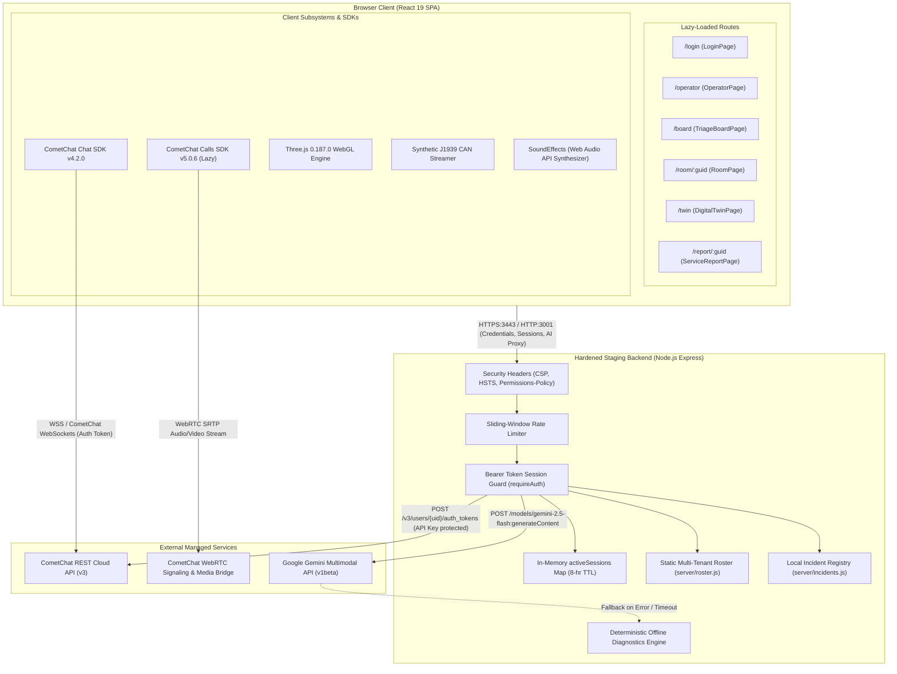
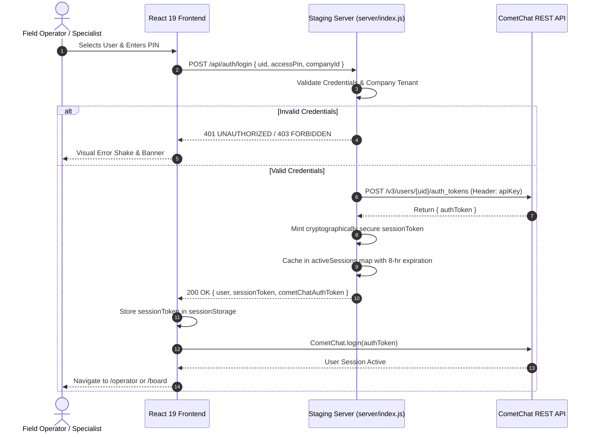
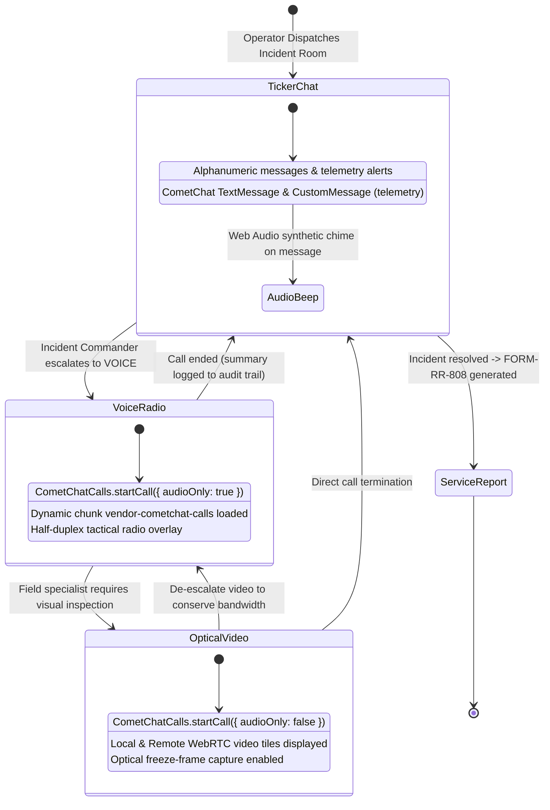
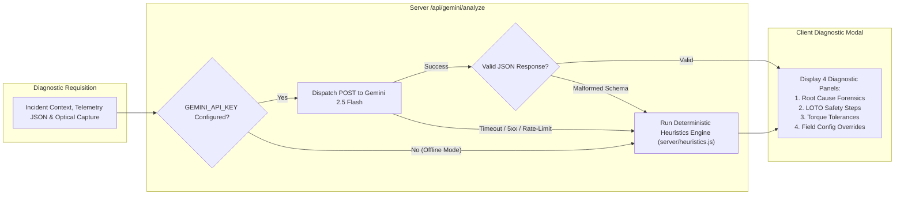
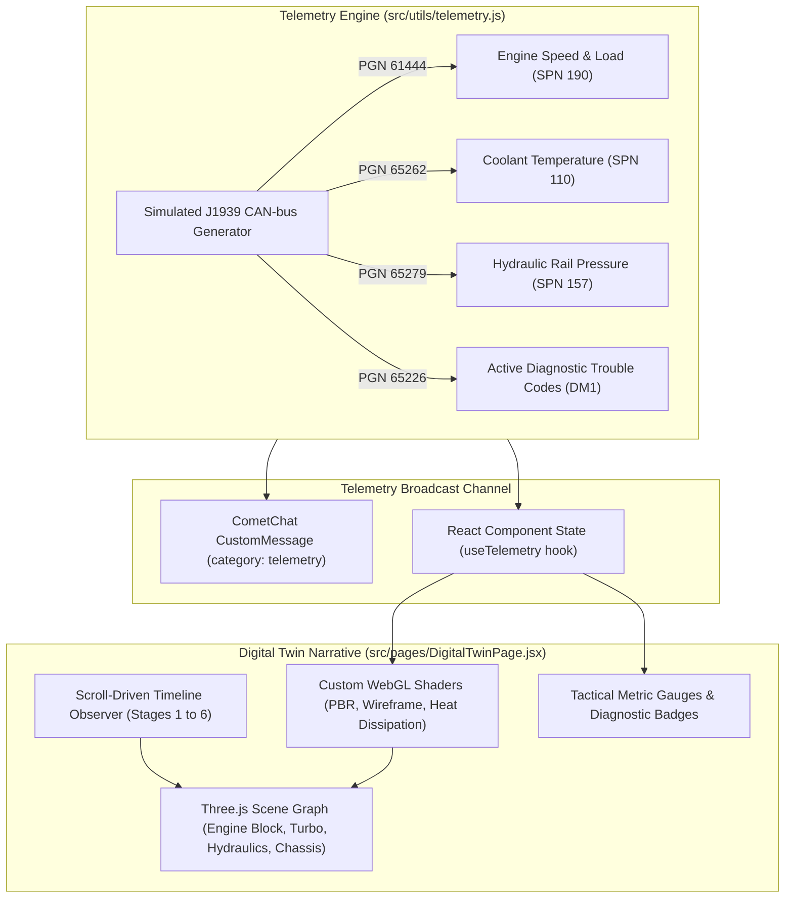

# RescueRoom System Architecture Diagrams

This document contains visual diagrams documenting RescueRoom's system topology, authentication sequence, kinetic escalation lifecycle, telematics data flow, and failure fallback modes.

---

## 1. End-to-End System Topography

---

## 2. Authentication & Session Minting Sequence

The client never possesses CometChat API keys or master credentials. Authentication flows through a strict two-stage process:

---

## 3. Kinetic Escalation Modality Lifecycle

RescueRoom transitions across synchronous and asynchronous communication channels within the active incident room:

---

## 4. Dual-Engine Diagnostic Pipeline (Gemini + Offline Heuristics)

RescueRoom ensures uninterrupted field operations through deterministic local failover if the remote AI model is unreachable:

---

## 5. Telematics & 3D Digital Twin Data Flow

