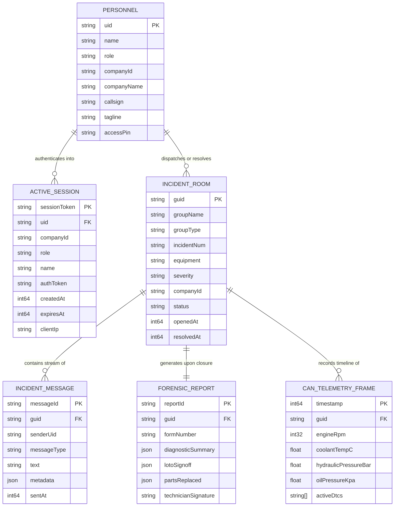

# RescueRoom Database & Data Model Specification

RescueRoom uses a real-time, hybrid distributed data architecture. Rather than relying on a traditional monolithic SQL database, data entities are partitioned between:
1. **CometChat Cloud Infrastructure:** Distributed persistent object store for Incident Channels (Groups), Message Streams, WebRTC Session Signaling, and Presence.
2. **Hardened Node.js Staging Server:** Cryptographic in-memory session registry (`activeSessions`), static multi-tenant personnel rosters, and server-side rate-limit records.
3. **Client Local Runtime:** Telemetry stream state, Three.js scene graph states, and ephemeral local storage caches.

---

## 1. Entity-Relationship Overview



---

## 2. Detailed Entity Schemas

### 2.1 Personnel Roster (`DEMO_USERS`)
Stored in `src/lib/roster.js` and consumed by both server authentication and client UI:

```typescript
interface PersonnelUser {
  uid: string;              // Unique identifier (e.g., "northwind_asha", "kestrel_dev")
  name: string;             // Full name (e.g., "Asha Patel")
  role: 'operator' | 'mechanic' | 'dispatcher'; // Role-based access level
  companyId: 'northwind' | 'kestrel';           // Tenant partition key
  companyName: string;      // Human-readable company brand
  callsign: string;         // Tactical radio callsign (e.g., "OP-NORTH-01")
  tagline: string;          // Operational assignment description
  accessPin: string;        // 4-digit security PIN for server-side verification
}
```

### 2.2 Active Server Session (`activeSessions`)
Managed in-memory by `server/index.js` with an 8-hour shift TTL:

```typescript
interface ActiveSession {
  sessionToken: string;     // Cryptographic bearer token ("rr_sess_" + 64 hex characters)
  uid: string;              // Authenticated user UID
  companyId: string;        // Tenant identifier (used for strict server-side access checks)
  role: string;             // Role of authenticated user
  name: string;             // Display name
  authToken: string | null; // CometChat REST-minted authentication token
  createdAt: number;        // Epoch timestamp (milliseconds)
  expiresAt: number;        // Expiration timestamp (createdAt + 8 hours)
  clientIp: string;         // Origin IP address for rate-limiting and audit trails
}
```

### 2.3 Incident Channel Group (`CometChat.Group`)
Managed via the CometChat Cloud API and synchronized across all active responders:

```typescript
interface IncidentGroupMetadata {
  incidentNum: string;       // Formatted incident ID (e.g., "INC-8192")
  equipment: string;         // Machinery identifier (e.g., "Excavator EX-204")
  severity: 'CRITICAL' | 'SERIOUS' | 'MINOR'; // Urgency classification
  companyId: 'northwind' | 'kestrel';         // Multi-tenant isolation key
  companyName: string;       // Corporate tenant title
  operatorUid: string;       // Dispatching operator UID
  operatorName: string;      // Dispatching operator name
  operatorCallsign: string;  // Radio callsign
  description: string;       // Fault narrative entered by operator
  openedAt: number;          // Epoch timestamp
  status: 'open' | 'resolved'; // Incident lifecycle state
  resolvedAt?: number;       // Timestamp when incident concluded
  resolutionNotes?: string;  // Closure comments by mechanic/dispatcher
}
```

*Channel Naming Convention:*
- **GUID:** `{companyId}_inc_{incidentNum}` (e.g., `northwind_inc_4821`, `kestrel_inc_9120`).
- **Group Name:** `INC-{incidentNum} · {equipment}`.
- **Group Type:** `CometChat.GROUP_TYPE.PUBLIC` (restricted to same-tenant users).

### 2.4 Incident Messages (`CometChat.TextMessage` & `CustomMessage`)
Messages within the incident room are typed and categorized:

| Category | Message Type | Payload / Structure |
| :--- | :--- | :--- |
| `operational` | `TextMessage` | Human-typed radio/ticker updates between operator and tech. |
| `dispatch` | `TextMessage` | Structured header block broadcast when room is opened. |
| `escalation` | `TextMessage` | System audit notice when switching modalities (`CHAT` → `VOICE` → `VIDEO`). |
| `telemetry` | `CustomMessage` | JSON payload containing current simulated J1939 CAN frame snapshot. |
| `evidence` | `MediaMessage` | Base64 or cloud-hosted optical snapshot of the machinery fault. |

### 2.5 Diagnostic Diagnosis Schema (`RESCUE-AI`)
Returned by `/api/gemini/analyze` (or the local deterministic heuristic fallback engine):

```json
{
  "componentIdentified": "High-Pressure 4-Spiral Hydraulic Hose SAE 100R15",
  "failureMode": "High-velocity pinhole hydraulic carcass rupture under cyclical pressure spike",
  "failureMechanics": [
    "Abrasive chafing against chassis bracket compromised outer chloroprene sheath",
    "Continuous impulse spikes up to 345 bar induced wire fatigue",
    "Tensile carcass burst ruptured inner synthetic nitrile liner"
  ],
  "severityAssessment": "CRITICAL - IMMEDIATE STOPPAGE",
  "immediateHazard": "Severe high-pressure fluid injection hazard (340+ bar) and thermal combustion risk",
  "oemParts": [
    { "partNumber": "CAT-154-8291", "name": "Arm Cylinder Flex Hose SAE 100R15", "cost": "$340.00", "leadTime": "In Stock" },
    { "partNumber": "PARKER-787TC-16", "name": "ToughCover Spiral Hose 5000 PSI", "cost": "$185.00", "leadTime": "1 Day" }
  ],
  "requiredTools": [
    "36mm Open-End Hydraulic Service Wrench",
    "Calibrated Click-Type Torque Wrench (50-250 Nm)",
    "Clean Fluid Catch Pan (20-liter capacity)"
  ],
  "torqueSpecifications": [
    { "item": "Flange Head Bolts", "spec": "145 Nm (107 ft-lb)", "lube": "Clean Engine Oil" },
    { "item": "Split Flange Halves Code 62", "spec": "170 Nm (125 ft-lb)", "lube": "Dry Thread" }
  ],
  "lotoChecklist": [
    "Step 1: Lower excavator boom, arm, and bucket completely to ground rest.",
    "Step 2: Shut down diesel engine and relieve hydraulic accumulator pressure by cycling joysticks 15 times.",
    "Step 3: Disengage master battery isolator switch and apply personal safety padlock.",
    "Step 4: Affix Danger/Do-Not-Operate tag with technician credentials and timestamp."
  ],
  "confidenceScore": 96,
  "recommendedAction": "Isolate hydraulic accumulator and replace failed hose segment before restarting prime mover.",
  "source": "GOOGLE_GEMINI_2_5_FLASH",
  "model": "Gemini 2.5 Flash Vision (Server Proxied)",
  "timestamp": "2026-11-16T03:50:00.000Z"
}
```

### 2.6 J1939 CAN-bus Telemetry Frame
Generated every 1000ms by `src/utils/telemetry.js`:

```typescript
interface J1939TelemetryFrame {
  timestamp: number;              // Current epoch millisecond
  engineRpm: number;              // SPN 190 (800 - 2200 RPM)
  coolantTempC: number;           // SPN 110 (75 - 118 °C)
  hydraulicPressureBar: number;   // SPN 157 (180 - 360 Bar)
  oilPressureKpa: number;         // SPN 100 (220 - 480 kPa)
  fuelLevelPercent: number;       // SPN 96 (0 - 100 %)
  engineHours: number;            // SPN 247 (Cumulative operating hours)
  activeDtcs: Array<{             // Diagnostic Trouble Codes (DM1)
    spn: number;
    fmi: number;
    description: string;
    severity: 'WARNING' | 'CRITICAL';
  }>;
}
```

---

## 3. Data Integrity & Multi-Tenant Partitioning Rules

1. **Deterministic GUID Prefix:** Every incident group identifier must strictly adhere to `{companyId}_inc_{randomId}`.
2. **Server-Side Enforcement:** When any incident is accessed (`/room/:guid`, `/report/:guid`, or `/api/auth/authorize-tenant`), the server verifies that `guid.startsWith(session.companyId + '_inc_')`.
3. **No Cross-Tenant Leaks:** CometChat group listings on `/operator` and `/board` filter exclusively for matching tenant prefixes.
4. **Session Isolation:** A token minted for `northwind_asha` cannot be used to read or modify `kestrel_*` records.
