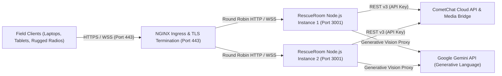

# RescueRoom Deployment & Operations Guide

This guide covers deployment architectures, containerization, environment configuration, reverse proxy setup, and operational runbooks for running RescueRoom in private staging and high-consequence production environments.

---

## 1. Architecture & Deployment Topography



---

## 2. Environment Variables Specification

RescueRoom uses strict separation between public client variables and privileged server variables:

### 2.1 Server Environment Variables (`.env` or Container Environment)
These variables must **NEVER** be committed to source control or exposed to the browser:

| Variable | Required | Default | Description |
| :--- | :---: | :---: | :--- |
| `PORT` | No | `3001` | HTTP port for backend server and static asset serving |
| `HTTPS_PORT` | No | `3443` | HTTPS port for local staging TLS testing |
| `COMETCHAT_APP_ID` | Yes | - | CometChat App ID (e.g. `1234567890abcdef`) |
| `COMETCHAT_REGION` | Yes | - | CometChat region code (`us`, `in`, `eu`) |
| `COMETCHAT_API_KEY` | Yes | - | Privileged CometChat REST API Key (Mints user tokens) |
| `GEMINI_API_KEY` | No | `""` | Google Gemini API Key (If omitted, heuristic engine engages) |
| `SSL_CERT_FILE` | No | `server/certs/cert.pem` | Path to TLS certificate for staging HTTPS |
| `SSL_KEY_FILE` | No | `server/certs/key.pem` | Path to TLS private key for staging HTTPS |

### 2.2 Client Build-Time Variables (`.env.production`)
Embedded into static JS bundle at build time:

| Variable | Required | Description |
| :--- | :---: | :--- |
| `VITE_COMETCHAT_APP_ID` | Yes | Public CometChat App ID |
| `VITE_COMETCHAT_REGION` | Yes | Public CometChat Region |

*Security Rule:* **NEVER** define `VITE_COMETCHAT_AUTH_KEY` or `VITE_GEMINI_API_KEY`. All authentication and AI calls must flow through the server proxy.

---

## 3. Production Containerization (`Dockerfile`)

Create a multi-stage `Dockerfile` in the project root:

```dockerfile
# Stage 1: Build the React 19 Frontend
FROM node:20-alpine AS builder
WORKDIR /app

COPY package*.json ./
RUN npm ci

COPY . .
RUN npm run build

# Stage 2: Hardened Production Server
FROM node:20-alpine AS runner
WORKDIR /app
ENV NODE_ENV=production

COPY package*.json ./
RUN npm ci --omit=dev

# Copy compiled frontend distribution and server runtime
COPY --from=builder /app/dist ./dist
COPY server/ ./server
COPY src/lib/roster.js ./src/lib/roster.js

# Run as non-root user for security hardening
USER node

EXPOSE 3001
CMD ["node", "server/index.js"]
```

---

## 4. Production Reverse Proxy Configuration (`nginx.conf`)

Deploy NGINX in front of the Node.js service for TLS 1.3 termination, caching, rate limiting, and WebSocket proxying:

```nginx
upstream rescueroom_backend {
    server 127.0.0.1:3001;
    keepalive 32;
}

server {
    listen 80;
    server_name rescueroom.company.internal;
    return 301 https://$host$request_uri;
}

server {
    listen 443 ssl http2;
    server_name rescueroom.company.internal;

    ssl_certificate /etc/ssl/certs/rescueroom.crt;
    ssl_certificate_key /etc/ssl/private/rescueroom.key;
    ssl_protocols TLSv1.2 TLSv1.3;
    ssl_ciphers HIGH:!aNULL:!MD5;
    ssl_prefer_server_ciphers on;

    # Security Headers
    add_header X-Content-Type-Options nosniff always;
    add_header X-Frame-Options SAMEORIGIN always;
    add_header X-XSS-Protection "1; mode=block" always;
    add_header Strict-Transport-Security "max-age=31536000; includeSubDomains" always;
    add_header Permissions-Policy "camera=(self), microphone=(self), geolocation=()" always;

    # Static asset caching
    location ~* \.(?:ico|css|js|gif|jpe?g|png|woff2?|eot|otf|ttf|svg|webp)$ {
        proxy_pass http://rescueroom_backend;
        expires 1y;
        add_header Cache-Control "public, max-age=31536000, immutable";
    }

    # API and WebSocket proxy
    location / {
        proxy_pass http://rescueroom_backend;
        proxy_http_version 1.1;
        proxy_set_header Upgrade $http_upgrade;
        proxy_set_header Connection "upgrade";
        proxy_set_header Host $host;
        proxy_set_header X-Real-IP $remote_addr;
        proxy_set_header X-Forwarded-For $proxy_add_x_forwarded_for;
        proxy_set_header X-Forwarded-Proto $scheme;

        # Timeouts for WebRTC signaling and long-lived SSE/websockets
        proxy_read_timeout 86400s;
        proxy_send_timeout 86400s;
    }
}
```

---

## 5. Process Supervision via Systemd or PM2

### 5.1 Systemd Service Unit (`/etc/systemd/system/rescueroom.service`)
```ini
[Unit]
Description=RescueRoom Industrial Emergency Operations Server
After=network.target

[Service]
Type=simple
User=rescueroom
WorkingDirectory=/opt/rescueroom
EnvironmentFile=/etc/rescueroom/rescueroom.env
ExecStart=/usr/bin/node server/index.js
Restart=always
RestartSec=5s
KillSignal=SIGTERM
TimeoutStopSec=10s

[Install]
WantedBy=multi-user.target
```

### 5.2 PM2 Process File (`ecosystem.config.cjs`)
```javascript
module.exports = {
  apps: [
    {
      name: 'rescueroom-staging',
      script: 'server/index.js',
      instances: 'max',
      exec_mode: 'cluster',
      env: {
        NODE_ENV: 'production',
        PORT: 3001,
      },
    },
  ],
};
```

---

## 6. Health Monitoring & Operational Runbook

### 6.1 Automated Liveness Probe
Deploy a periodic monitoring check against:
```http
GET /api/health
```
Assert that the response returns `200 OK` and `"status": "healthy"`.

### 6.2 Zero-Downtime Staging Deployment Sequence
```bash
# 1. Pull latest verified release
git fetch origin main && git checkout tags/v1.0.0

# 2. Install production dependencies
npm ci

# 3. Compile static client bundle
npm run build

# 4. Run static validation & regression tests
npm run lint
node scratch/stage5_full_regression.mjs

# 5. Signal zero-downtime reload to server
pm2 reload rescueroom-staging
```
