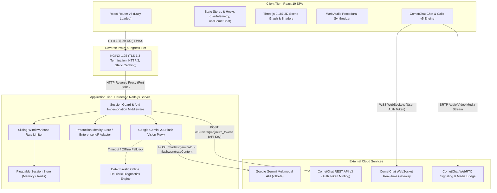

# RescueRoom — System Architecture Overview

This document provides a comprehensive structural overview of RescueRoom's full-stack architecture, data flow pathways, security perimeters, and deployment layers.

---

## 1. High-Level Architectural Diagram

---

## 2. Tiered System Breakdown

### 2.1 Client Application Tier
- **Framework:** React 19.2.8 with React Router v7.18.4.
- **3D Engine:** Three.js 0.187.0 utilizing procedural geometry generation and custom GLSL vertex/fragment shaders.
- **Real-Time Communications:** Headless CometChat JavaScript SDK v4.2.0 for alphanumeric chat and presence; Calling SDK v5.0.6 for WebRTC voice and video calls.
- **Design System:** Bespoke Vanilla CSS tokens (`src/styles/design-tokens.css`) adhering to physical workshop manual aesthetics and WCAG 2.1 AA accessibility guidelines.

### 2.2 Security & Ingress Tier
- **Ingress Controller:** NGINX 1.25 providing TLS 1.3 termination, HTTP/2 multiplexing, static asset caching with 1-year immutable headers, and client request body buffering (15 MB maximum for optical plate uploads).
- **Defense Headers:** Injects strict `Content-Security-Policy`, `Permissions-Policy: camera=(self), microphone=(self)`, `Strict-Transport-Security: max-age=31536000`, `X-Content-Type-Options: nosniff`, and `X-Frame-Options: SAMEORIGIN`.

### 2.3 Application Server Tier
- **Runtime:** Node.js 20+ with ES Module support (`server/index.js`).
- **Session Management:** Cryptographic 32-byte hexadecimal session tokens (`rr_sess_*`) with an 8-hour shift lifespan. Sweeps expired sessions every 10 minutes.
- **Pluggable Session Store:** Implements an extensible `SessionStore` interface (in-memory Map for single-instance staging, Redis for distributed cluster deployments).
- **Anti-Impersonation & Tenant Isolation:** Server verifies that client token requests strictly match the authenticated session UID, and validates incident GUID prefixes against the session `companyId`. Cross-tenant attempts are rejected with `HTTP 403`.
- **Sliding-Window Rate Limiting:** Enforces independent per-IP limits: 10 attempts/min on `/api/auth/login`, 30/min on `/api/auth/token`, and 20/min on `/api/gemini/analyze`.

### 2.4 External Managed Cloud Services
- **CometChat Cloud:** Manages persistent incident channel groups, message ordering, push signaling, and WebRTC peer negotiation.
- **Google AI Studio:** Provides multimodal visual damage analysis via Gemini 2.5 Flash Vision.

---

## 3. Data Protection & Zero-Trust Perimeters

| Security Perimeter | Implementation | Enforcement Point |
| :--- | :--- | :---: |
| **API Key Custody** | `COMETCHAT_API_KEY` and `GEMINI_API_KEY` reside exclusively in the server environment. | Node.js Server Environment |
| **Identity Impersonation** | Clients cannot request CometChat tokens for arbitrary UIDs. Token minting is derived from server session. | `/api/auth/token` |
| **Tenant Isolation** | Corporate fleets are partitioned by GUID prefix (`northwind_inc_*` vs. `kestrel_inc_*`). | `/api/auth/authorize-tenant` |
| **Abuse Protection** | Sliding-window per-IP rate limiters prevent brute-force credential stuffing and AI exhaustion. | Server Request Middleware |
| **Media Type Restrictions**| Optical evidence plate uploads validate MIME types against `image/jpeg`, `image/png`, and `image/webp`. | `/api/gemini/analyze` |
| **Data Redaction** | Console logs mask session tokens (`rr_s...01`), strip credentials, and never print PINs. | Server Logging Layer |

