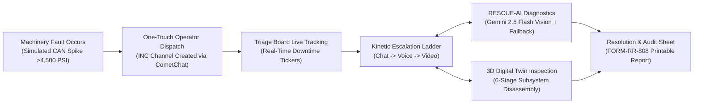

# RescueRoom — Project Executive Overview

**Domain:** Heavy Industrial Mobile Equipment · Emergency Dispatch · Remote Telematics Diagnostics  
**Primary Tech Stack:** React 19, Three.js 0.187, CometChat JS Chat SDK v4 & Calling SDK v5, Google Gemini 2.5 Flash Vision, Node.js, Vite 8  
**Design Philosophy:** Field Workshop Manual Aesthetic (Custom Vanilla CSS Design Tokens, Paper Cards, High-Contrast Tactical Ink Stamps)

---

## 1. The High-Consequence Industrial Problem

In high-consequence operations—including open-pit mining, aggregate quarrying, major civil earthworks, and heavy freight transport—unscheduled machinery breakdowns represent catastrophic operational losses:

- **Downtime Costs:** Heavy mobile equipment breakdowns (e.g., 200-ton hydraulic excavators, 100-ton haul trucks) incur downtime costs ranging from **\$5,000 to \$25,000 per hour** in lost production, idle crews, and delayed logistics chains.
- **Communication Latency:** Field operators in remote quarry pits often communicate over fragmented, lossy analog radios or consumer messaging apps. Diagnostics are verbally miscommunicated, leading to incorrect parts dispatch and multi-day maintenance delays.
- **Extreme Field Operating Conditions:** Technicians work under direct solar glare, wearing heavy industrial gloves, facing high acoustic noise environments ($> 85\text{ dB}$), and operating over fluctuating cellular/satellite links. Consumer chat interfaces fail in these conditions due to low contrast, tiny touch targets, and brittle connectivity handling.

---

## 2. The RescueRoom Solution

RescueRoom is an enterprise field emergency dispatch, telematics, and remote diagnostics platform engineered specifically to resolve high-consequence industrial machinery breakdowns.

---

## 3. Core Capabilities & Product Innovations

### 3.1 Three-Tier Kinetic Escalation Ladder
Unifies text, voice, and video into a single operational channel, allowing technicians to dynamically match bandwidth and ambient noise conditions without opening separate applications:
1. **Rung 1: Monospace Ticker Chat (`CHAT`):** Low-bandwidth alphanumeric messaging with synthesized Web Audio tactical beeps for high-noise ambient environments.
2. **Rung 2: Tactical Half-Duplex Voice Radio (`VOICE`):** WebRTC voice stream powered by CometChat Calls SDK, featuring real-time audio oscilloscope visualizers and participant presence strips.
3. **Rung 3: Full Optical Video Feeds (`VIDEO`):** High-definition visual inspection stream with HUD crosshairs, optical freeze-frame capture, and hardware mute toggles. Automated call duration notices are scribed directly into the chat audit trail upon call conclusion.

### 3.2 Interactive 3D Mechanical Digital Twin Studio (`/twin`)
A bespoke, scroll-choreographed Three.js mechanical assembly featuring:
- **6-Stage Disassembly Narrative:** Explodes from high-level chassis overview to hydraulic valve block, boom cylinder gland, carcass rupture point, AI damage scan, and pressurized reassembly.
- **Custom WebGL Shaders:** Features live-switchable rendering modes including Procedural PBR, CAD Blue Wireframe (`gl_FragColor = vec4(0.12, 0.44, 0.88, 1.0)`), and X-Ray Ghost Transparency.
- **Performance:** Sustained **58.7 FPS** rendering on standard integrated graphics with zero WebGL buffer leaks.

### 3.3 Dual-Engine Multimodal AI Diagnostics (`RESCUE-AI`)
- **Remote Model:** Proxies optical evidence plate photographs and telematics context to **Google Gemini 2.5 Flash Vision** via a secure server endpoint (`/api/gemini/analyze`).
- **Structured Output:** Delivers 4 operational tabs:
  1. *Forensics:* Technical component identification, failure mechanics, and OEM replacement part numbers (Caterpillar, Parker Hannifin, Bosch).
  2. *LOTO:* Step-by-step Lockout/Tagout physical safety isolation checklists.
  3. *Torque Tolerances:* Fastener tightening specifications and lubrication requirements.
  4. *Field Overrides:* Hydraulic bypass pressures and emergency operational thresholds.
- **Tactical Offline Fallback:** If internet connectivity drops or API keys are unavailable, the built-in deterministic heuristic rule engine immediately analyzes the fault, guaranteeing zero downtime in remote cellular blackouts.

### 3.4 Forensic Maintenance Service Report (`FORM-RR-808`)
- Concludes the emergency lifecycle by compiling an auditable, physical-sealed service report.
- Features failure vs. post-repair telemetry deltas, parts replaced manifests, technician signatures, and a dedicated `@media print` layout for PDF export and regulatory compliance records.

---

## 4. Multi-Tenant Enterprise Fleets

RescueRoom enforces strict multi-tenant isolation at both the UI and backend middleware layers:
- **Northwind Heavy Equipment (`northwind_*`):** Surface mining and heavy earthmoving fleet operating 200-ton hydraulic excavators and off-highway haul trucks.
- **Kestrel Logistics (`kestrel_*`):** Regional freight and material-handling fleet operating heavy road transports and industrial telehandlers.

Cross-tenant room access is blocked server-side (`HTTP 403 CROSS_TENANT_VIOLATION`), ensuring corporate privacy and zero data leakage across competing contractors.

