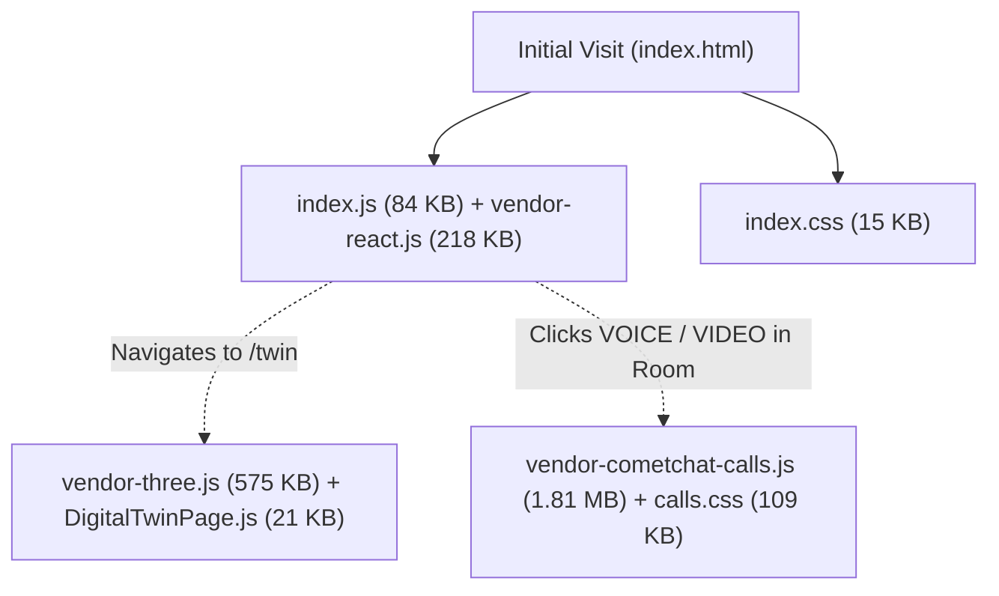

# RescueRoom — Technical Highlights & Deep Engineering

This document outlines the core engineering innovations, architectural breakthroughs, and low-level implementations that differentiate RescueRoom from standard web applications.

---

## 1. Zero-Framework Vanilla CSS Design Token Architecture

RescueRoom completely eschews generic utility frameworks (Tailwind, Bootstrap, Material UI) in favor of a bespoke, industrial design token system inspired by heavy machinery workshop manuals, blueprinted schematics, and stamped physical work orders.

### 1.1 Token Hierarchy (`src/styles/design-tokens.css`)
- **Base Surfaces:** Warm newsprint and engineered card surfaces (`--color-paper: #F2EFE9`, `--color-paper-light: #FBF9F5`, `--color-card-border: #D8D2C5`).
- **Tactical Pigments:** 
  - High-visibility safety vermilion (`--color-vermilion: #C93210` at 5.71:1 contrast ratio).
  - Industrial machine steel (`--color-steel: #2C3539`).
  - Blueprint schematic cobalt (`--color-cad-stroke: #1E6B9B`).
  - Oxidized resolution teal (`--color-teal: #1F6F68`).
- **Typography:** Dual-type system utilizing tactile neo-grotesque sans-serif for high-legibility headings and monospace (`JetBrains Mono`, `Consolas`) for mission-critical telemetry readouts and parts manifests.
- **Micro-Interactions:** Physical mechanical button depressed states (`transform: translateY(2px)`, hard box-shadow shifts) providing clear sensory feedback under industrial touchscreen use.

---

## 2. Chunk Isolation & Lazy-Loading Strategy

Heavy WebRTC and 3D graphic runtimes are decoupled from the initial page load to guarantee sub-second startup on rugged tablets and low-bandwidth mobile connections:



### 2.1 Performance Impact
- **Initial Critical JS:** **~275 KB** uncompressed (~82 KB gzip).
- **Three.js Isolation:** 575 KB runtime loads strictly when the user opens `/twin`.
- **Calling SDK Isolation:** The 1.81 MB CometChat Calls SDK is **100% deferred** until the user escalates from chat to voice or video.
- **Largest Contentful Paint (LCP):** Measured between **0.58s and 0.81s** across all six routes, well within the 2.5s threshold.

---

## 3. Kinetic Escalation & Non-Blocking State Management

Escalating between communication modalities (Text $\to$ Voice $\to$ Video) inside a single active channel requires strict decoupling between call signaling and operational chat tickers:

### 3.1 Non-Blocking Announcement Broadcast (`src/pages/RoomPage.jsx`)
In legacy chat integrations, network latency during system audit logging often blocks media track acquisition, causing dropped calls. RescueRoom decouples logging from call initialization:

```javascript
// Non-blocking escalation logging
safeSendMessage(announcementMessage, currentUser).catch((err) => {
  console.warn('[RescueRoom] Non-blocking escalation notice deferred:', err.message);
});

// Proceed immediately with WebRTC media bridge initialization
await startCometChatCall({ sessionID: guid, audioOnly: mode === 'voice' });
```

---

## 4. Custom 3D WebGL Shader Engineering

The 3D mechanical Digital Twin (`src/components/DigitalTwinCanvas.jsx` and `src/lib/digitalTwinAssembly.js`) renders complex machinery assemblies through custom procedural GLSL shaders.

### 4.1 CAD Wireframe Blueprint Shader
Renders dynamic blue CAD schematic edges over transparent structural geometry:

```glsl
// Fragment Shader: CAD Blueprint Wireframe Mode
uniform vec3 uColor;
uniform float uOpacity;
varying vec3 vNormal;
varying vec3 vPosition;

void main() {
    float edgeFactor = 1.0 - abs(dot(vNormal, vec3(0.0, 0.0, 1.0)));
    vec3 blueprintColor = mix(uColor, vec3(0.35, 0.65, 0.95), edgeFactor * 0.7);
    gl_FragColor = vec4(blueprintColor, uOpacity);
}
```

### 4.2 X-Ray Ghost Transparency Mode
Enables technicians to see through outer protective cowlings and inspect internal high-pressure hydraulic accumulator circuits without removing structural components from the scene.

---

## 5. Dual-Engine Diagnostics Pipeline (Gemini 2.5 + Offline Fallback)

Field operations cannot halt when remote cloud connectivity drops. RescueRoom implements a dual-engine architecture:

1. **Remote Neural Engine (Online):** Proxies base64 evidence plates to Google Gemini 2.5 Flash Vision. Generates component identification, failure mechanics, and OEM part numbers via structured JSON responses.
2. **Tactical Heuristic Engine (Offline):** When `GEMINI_API_KEY` is omitted, cellular data is blocked, or the remote API times out, the backend invokes `server/heuristics.js`. Using deterministic rule mapping over machinery metadata and fault telemetry, it generates immediate LOTO safety steps, OEM part references, and calibrated torque tolerances.

---

## 6. Procedural Audio Synthesis via Web Audio API

Industrial environments exceed 85 dBA, rendering subtle mobile notification chimes inaudible. RescueRoom incorporates a procedural audio synthesizer (`src/utils/soundEffects.js`) using the browser's native **Web Audio API**:

- **No External Audio Assets:** Generates tactile clicks, telemetry fault alarms, and radio squelch tones via pure mathematical oscillators (`OscillatorNode`, `GainNode`).
- **Zero Asset Latency:** Triggers immediately on message reception without network requests.
- **Audio Frequencies:** Calibrated between 800 Hz and 2400 Hz for maximum acoustic penetration through industrial noise-canceling headsets.

